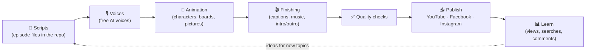
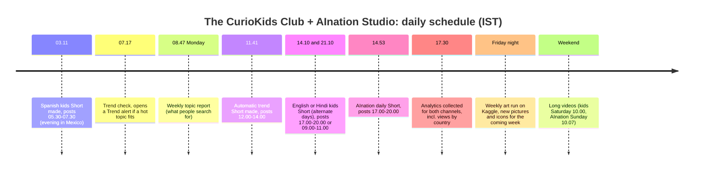
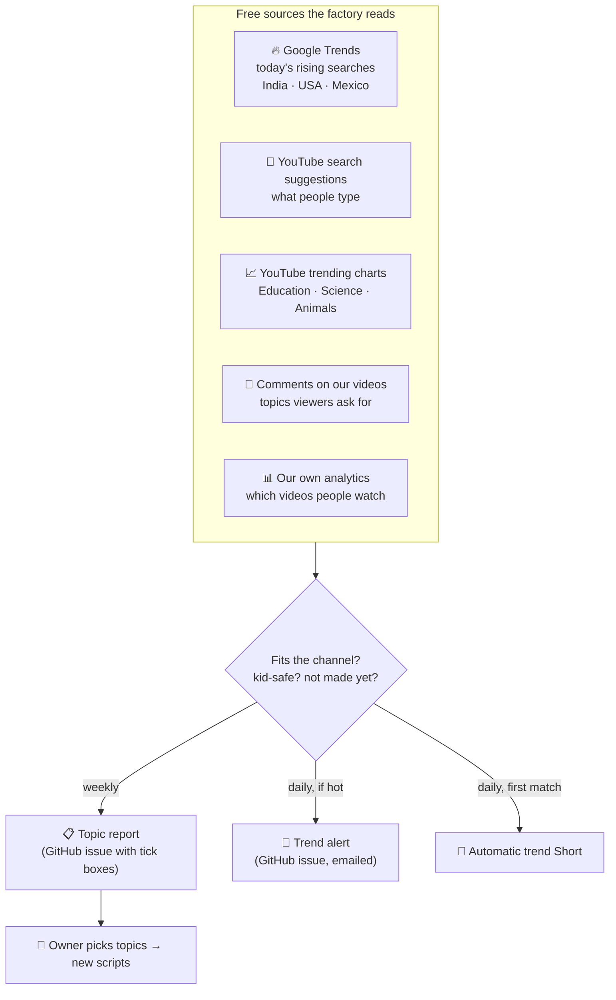
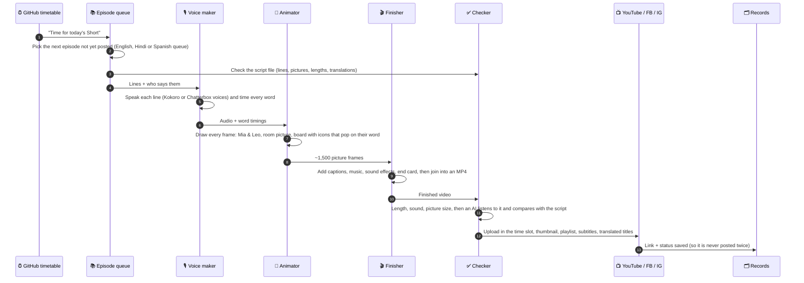
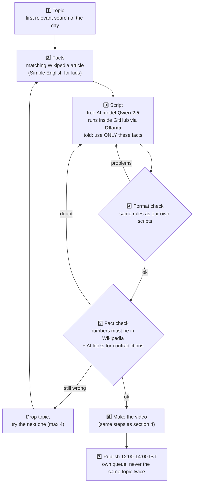
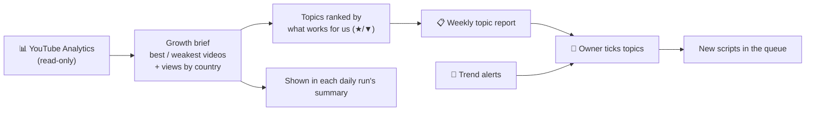

# How it works: the video factory in plain words

**For:** anyone, no technical background needed. **Same file in both repos.** Last updated 2026-11-23 09:15 (IST).
The diagrams below are drawn by GitHub automatically when you open this file on github.com.

---

## 1. The big picture

Think of it as a small **factory that runs by itself every day**. The factory building is **GitHub** (a free service that stores the project and runs jobs on a timetable). Each "job" is a recipe that turns a written script into a finished video and posts it.

Nobody has to press a button: GitHub starts each job at a fixed time. The owner only adds new content, flips switches, and (until Google approves the API audit) makes uploaded videos public in YouTube Studio.

---

## 2. A day in the factory (times in India, IST)

---

## 3. Where topics come from

**"Fits the channel"** means: kids = science, nature, body, space, weather, festivals (never anything on the block list); AInation = AI, apps, phones, chips. Sport, celebrities and news are ignored.

---

## 4. How one Short is made (step by step)

What each step uses:

| Step | What does the work | Free / open? |
|---|---|---|
| Voices | **Kokoro** (English, Hindi, Spanish voices) and **Chatterbox** (more expressive English) | yes, open licences (Apache 2.0, MIT) |
| Characters, boards, animation | our own drawing code (**Skia** graphics library). Steady camera; the speaker gets a golden spotlight and steps forward; a board stays until the next picture appears | yes |
| Background pictures, picture boards, 3D icons | made on a free **Kaggle** GPU with **FLUX.1-schnell** (image AI) + **rembg** (cut-outs): by hand so far, and from now on by the **weekly art run** (it makes only what upcoming episodes are missing); extra icons from **Microsoft Fluent Emoji 3D** | yes (Apache 2.0, MIT) |
| Real photos (AInation) | **NASA** and **Openverse** (free-licence photos, credited) | yes |
| Music | composed by our code for each episode | yes |
| Captions, joining, sound | **FFmpeg** | yes |
| Listening check | **faster-whisper** (speech-to-text AI) | yes (MIT) |
| Upload | **YouTube Data API**, **Meta** (Facebook/Instagram) | free with limits |

---

## 5. How the automatic trend Short is written

No paid AI service is used: the AI model is downloaded free and runs on GitHub's computer for a few minutes.

---

## 6. Learning and improving

---

## 7. Safety nets (why a bad video doesn't go out)

- Every script is **checked before anything is drawn**; a broken script stops the run with a list of problems.
- Pictures that can't be drawn (e.g. combined emoji 🦸‍♂️) are replaced by plain ones.
- Kids channel: a **block list** of words and topics that are never used.
- Finished video is **checked** (length, sound, size) and an AI **listens** to it.
- Automatic scripts: facts **only from Wikipedia**, numbers verified, contradictions checked; if unsure, the topic is skipped.
- Every upload is **recorded**, so nothing is posted twice.
- Every feature has an **on/off switch** (see `CONFIGURATION.md`).

---

## 8. What the owner does

| Task | How often |
|---|---|
| Push the bundles (code updates) | when a new bundle arrives |
| Make uploaded videos public in YouTube Studio | daily, until Google approves the API audit |
| Tick topics in the weekly report / react to trend alerts | weekly / as they come |
| Change switches (variables) | rarely: list in `CONFIGURATION.md` |
| Check the weekly art run's new pictures (Artifacts) | weekly, until automatic install (`ART_AUTO_COMMIT=on`) is trusted |

Open tasks: `docs/TODO.md`. Plans: `docs/PRIVATE_CODE_PLAN.md`, `docs/PINTEREST_PLAN.md`. More detail: `CONFIGURATION.md` (all switches), `docs/AUTOMATION_KAGGLE.md`, `docs/TREND_SHORTS.md`, `docs/SPANISH.md`, `docs/RADAR_AND_ALERTS.md`, `docs/HD_ART.md`.
